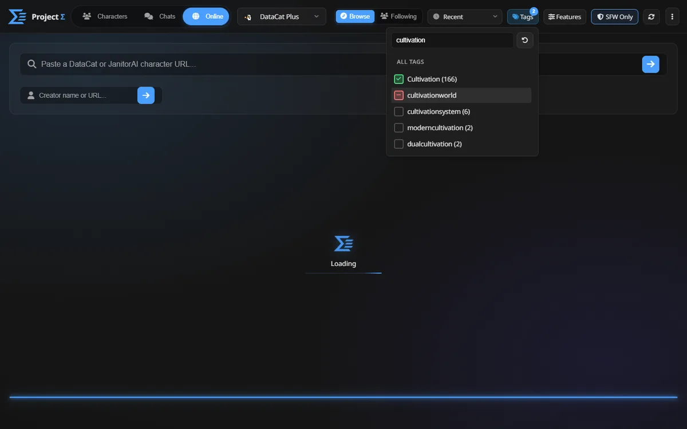
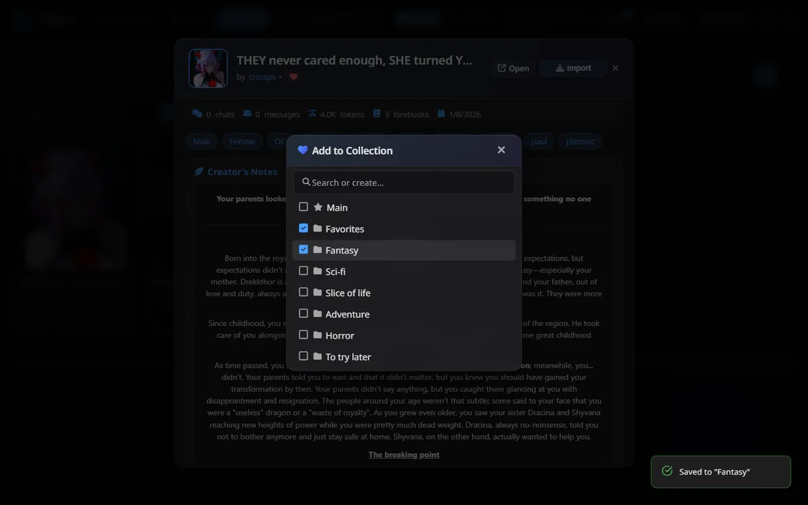
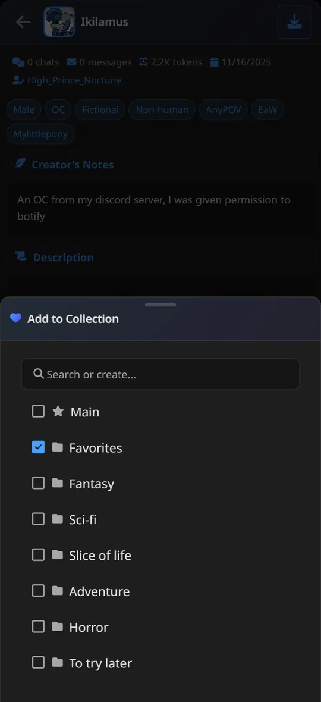

# DataCat Plus

A [Project Σ](https://github.com/Sillyanonymous/ProjectSigma) provider extension for [DataCat](https://datacat.run). It brings Character Library's full DataCat browser into Sigma: DataCat, JanitorAI and Hampter search, cloud extraction, your DataCat account's collections and follows, tag blocking that syncs with the site, and missing-avatar restore. It uses Sigma's own UI on desktop and phone.

> **Beta.** Report problems on the GitHub issues page.

## Features

- **Browse and search:** DataCat's Recent and Fresh feeds, JanitorAI search, and Hampter's sorts. Also creator pages, a Following tab, SFW/NSFW, Sigma's feature filters, and "in library" badges on cards you already have.
- **Every tag DataCat has:** creators' custom tags show in the preview and stay on the card you import. In the Tags dropdown, each tag cycles **include → block → clear**.
- **Blocking synced with your account:** signed in, the tags you block go to your DataCat block list, the one datacat.run itself uses. The site and your other devices then hide the same tags.
- **Cards published on DataCat:** cards uploaded straight to DataCat ("DC Published", marked **DC**) preview and import complete, lorebook included.
- **Collections:**
  - **Add to Collection** uses Sigma's own Add to Playlist picker: tick or untick collections, or type a name to create one.
  - Each row shows a spinner until DataCat confirms the save.
  - On a phone it's a bottom drawer that stays above the keyboard.
  - A **Collected** view and a drag-to-reorder collection order in settings.
- **Cloud extraction:** fetches cards whose definitions are hidden, using your account if you choose.
- **Update checks:** imported cards can be checked for changes, as with Sigma's other providers.
- **Missing avatars:** a restore tool finds lost avatars again.

| Tags: include and block | Add to Collection |
|---|---|
|  |  |

| Preview | Settings |
|---|---|
|  |  |

## Install

1. In Sigma, open **Settings > Extensions**. Paste `https://github.com/DJLegends1011/sigma-datacat-plus` and press **Install**. Or download the zip from [Releases](https://github.com/DJLegends1011/sigma-datacat-plus/releases) and use **Install from a File**.
2. Turn **DataCat Plus** on.
3. In **Settings > Online**, **switch off Sigma's built-in DataCat** to avoid duplicate provider tabs and DOM ID clashes.
4. Optional: in the DataCat Plus section of **Settings > Online**, sign in with your DataCat account for collections, follows, synced blocking and account extraction.

Needs Sigma with extension API 2.7 or newer.

## Privacy, Storage & Network

- **What it reads**: Extension settings (`datacatNsfw`, `datacatPublicFeed`, `datacatReextractOnUpdate`, `datacatSyncYours`, `datacatUseAccountForExtraction`, `datacatFollowedCreators`, `datacatFollowMigrated`, `datacatBlockedTags`), your Sigma character list for in-library badges and avatar restore, and the app-wide `importMediaAction` setting.
- **What it writes**: Its own server-side session/account storage table (per Sigma account) and its own extension settings under `datacat-plus`. Characters you import are saved through Sigma's normal character import pipeline with link metadata under `data.extensions[PROVIDER_ID]`.
- **What it sends and where**:
  - Browse, search, extraction, folder, and follow requests go to `datacat.run` (and `ella.janitorai.com` for avatars / JanitorAI MeiliSearch where selected) through this extension's server half at `/api/ext/datacat-plus/dc-*`.
  - When you sign in to a DataCat account, your email and password are sent **only** in the POST body to `datacat.run` (`/api/auth/login`) via this extension's server half. The password input is cleared immediately after submission and is never stored. Account and anonymous session tokens are kept server-side only (never stored in client settings).
  - **Blocked tags:** signed in to a DataCat account, the tags you block in the Tags dropdown are your account's own block list on `datacat.run` (`/api/user-preferences/character-filters`, the list DataCat's site uses), so the site and your other devices block the same tags; only its tags part is changed. Signed out, the list stays in this extension's settings. The blocked tag ids are also sent with browse requests (`blockedTagIds`).
  - **JanitorAI login (optional, for the Hampter sorts):** the session you paste is stored server-side per Sigma account (table `x_datacat_plus_jai`), and the refresh token never leaves the server. The page asks `/api/ext/datacat-plus/jai-token` for a current, short-lived **access** token when it pages a Hampter sort, because that request runs in your browser (which holds JanitorAI's Cloudflare pass) and goes straight to JanitorAI. An earlier build kept the pair in client settings; on first start it is handed to the server and cleared from settings.

## Licence

**AGPL-3.0** — derived from [Character Library](https://github.com/Sillyanonymous/SillyTavern-CharacterLibrary) (Sillyanonymous and contributors) and DJLegends' DataCat branch (`codex/datacat-account-sync`).

## Roadmap

- **Public collections:** browse other people's DataCat collections, once Sigma's collections extension is out.
- **Hosted-browser fallback:** if Cloudflare starts challenging server-side requests.
- **Namespace migration:** switch to `datacat` once Sigma retires its built-in DataCat (`PROVIDER_ID` + manifest `extNamespace`). Cards imported under `datacat-plus` are moved over through `ctx.stores.characters`, so none are orphaned.
