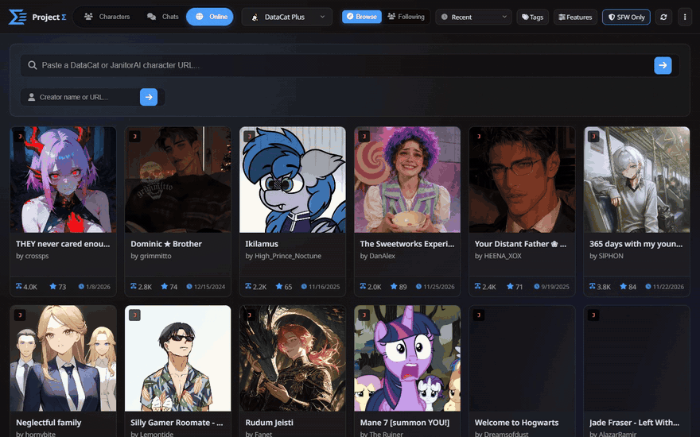
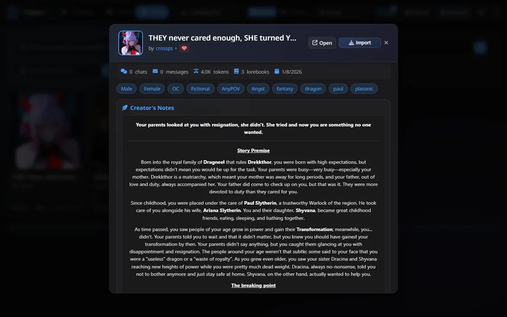
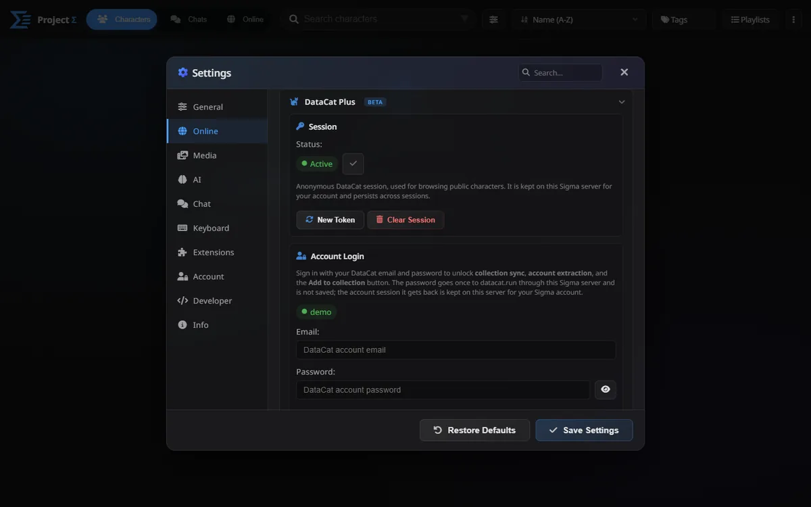

# DataCat Plus

**Browse [DataCat](https://datacat.run) inside [Project Σ](https://github.com/Sillyanonymous/ProjectSigma) and import its characters with one click.** If you have a DataCat account, your collections, follows and blocked tags work here too, the same as on the site. It looks and works like Σ's other online sources, on desktop and phone.

> **Beta, and made by a community member, not the Σ team.** Read the "What it touches" section below before you install. Report problems on the GitHub issues page.

## What it does

- **Browse and search DataCat:** the Recent and Fresh feeds, creator pages, the people you follow, SFW/NSFW, and Σ's usual filters. Cards you already have are marked "in library".
- **Also searches JanitorAI listings** (through Σ's own JannyAI search) and Hampter's sorts.
- **Every tag DataCat has:** the creator's own tags show in the preview and stay on the card you import. In the Tags list, tap a tag to include it, again to block it, again to clear it.
- **Blocked tags follow your account:** signed in, a tag you block here is blocked on datacat.run and your other devices too.
- **Collections:** tap the heart on a character, tick the collections it goes in, or type a name to make a new one. Each row spins until DataCat confirms the save. There's a **Collected** view, and you can drag your collections into order in settings.
- **Hidden definitions:** for a card whose definition is hidden, it can ask DataCat to extract it (with your account, if you choose).
- **Cards published on DataCat** (marked **DC**) import complete, lorebook included.
- **Update checks** and a **missing-avatar restore**, as with Σ's other sources.

| Tags: include and block | Add to Collection |
|---|---|
|  |  |

| Preview | Settings |
|---|---|
|  |  |

## Install

1. Read the source first: it's all in this repo, unminified.
2. In Σ, open **Settings > Extensions**. Paste `https://github.com/DJLegends1011/sigma-datacat-plus` and press **Install**, or download the zip from [Releases](https://github.com/DJLegends1011/sigma-datacat-plus/releases) and use **Install from a File**.
3. Turn **DataCat Plus** on.
4. In **Settings > Online**, **turn off Σ's built-in DataCat**. Both at once would show two DataCat tabs that get in each other's way.
5. Optional: in the DataCat Plus section of **Settings > Online**, sign in to your DataCat account for collections, follows, synced blocking and account extraction.

Needs Σ with extension API 2.7 or newer.

## What it touches, and what it sends

**It has a server half** (code that runs on the computer hosting Σ, not just in the page). That half does two things: it passes your requests on to datacat.run (a web page can't call DataCat directly), and it keeps your DataCat and JanitorAI logins so they never sit in the page or in your settings.

**Sends, and where:**
- **To datacat.run:** everything you browse, search, extract, follow, collect or block, through the server half. When you sign in, your email and password go to DataCat's login once and are not saved anywhere; only the login DataCat hands back is kept.
- **Your blocked tags,** when signed in, are saved to your DataCat account's block list (the one the site uses). Only the tags part of that list is changed. Signed out, they stay in this extension's settings. The blocked tags are also sent with each browse request so DataCat leaves those cards out.
- **JanitorAI search** goes through Σ's own JannyAI search (search.jannyai.com), straight from the page.
- **To janitorai.com, from the page:** a JanitorAI card's public lorebook when you preview or import it, and the pages of Hampter's sorts.
- **Your JanitorAI login (optional, only for Hampter's sorts):** if you paste your JanitorAI login cookie in settings, it's kept by the server half and only a short-lived pass is handed to the page, which talks to janitorai.com directly (it has to, because of JanitorAI's bot check). Renewing that login goes to JanitorAI's login service (supabase.co).
- **Pictures** (character avatars) load straight from datacat.run, ella.janitorai.com or saucepan.ai, like any web image.
- Nothing is sent anywhere else, and nothing is sent to the extension's author.

**Writes:**
- Two tables of its own in Σ's database, one row per Σ account: your DataCat session (a guest one for browsing, plus your login if you sign in) and your JanitorAI login. **Log Out** in settings clears the saved login.
- Its own settings (NSFW, followed creators, blocked tags when signed out, and so on).
- Characters you import, saved through Σ's normal import like any other source, with a link back to their DataCat page.

**Reads:** its own settings, your character list (for the "in library" marks and the avatar restore), and Σ's "what to do with card images on import" setting.

Turning it off stops it. It does not undo imports or account changes it already made (collections, follows, blocked tags live on your DataCat account).

## Licence

**AGPL-3.0.** Built from [Character Library](https://github.com/Sillyanonymous/SillyTavern-CharacterLibrary)'s DataCat provider (Sillyanonymous and contributors) and DJLegends' DataCat branch (`codex/datacat-account-sync`).

## Roadmap

- **Public collections:** browse other people's DataCat collections, once Σ's collections extension is out.
- **A fallback through Σ's hosted browser,** if DataCat's bot check ever starts blocking the server half.
- **Taking over the `datacat` name** once Σ retires its built-in DataCat, moving cards you imported with Plus over so none lose their link.
